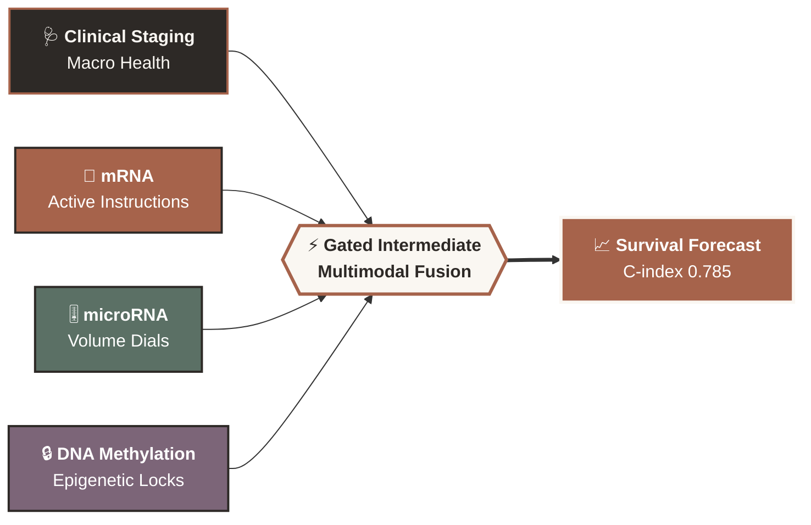
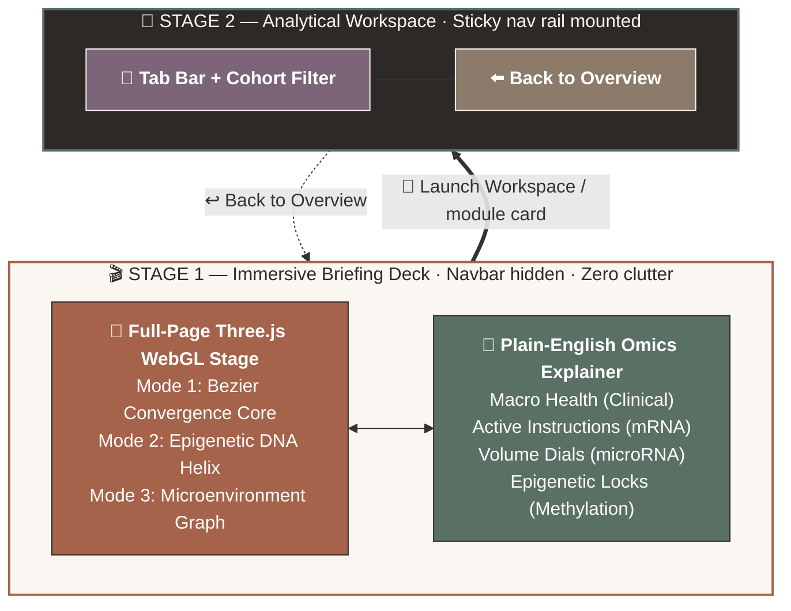

<div align="center">


<em>Uniting Clinical Staging, Active mRNA Transcriptomics, microRNA Volume Dials, and Epigenetic DNA Methylation Locks into a Unified Prognostic Survival Core.</em>

<br/><br/>


<br/>

<a href="https://nextjs.org/"></a>
<a href="https://www.typescriptlang.org/"></a>
<a href="https://threejs.org/"></a>
<a href="https://tailwindcss.com/"></a>
<a href="https://www.cancer.gov/ccg/research/genome-sequencing/tcga"></a>
<a href="./LICENSE"></a>

<br/><br/>

<a href="#3-interactive-3d-webgl-engine-showcase"><b>🚀 Interactive Demo</b></a> &nbsp;•&nbsp;
<a href="#2-design--architecture-philosophy"><b>🏛️ Architecture & UX</b></a> &nbsp;•&nbsp;
<a href="#4-analytical-modules--features"><b>🧪 Analytical Modules</b></a> &nbsp;•&nbsp;
<a href="#6-quick-start--local-setup"><b>⚙️ Quick Start</b></a> &nbsp;•&nbsp;
<a href="#7-data-provenance-citations--compliance"><b>📚 Data & Citations</b></a>

</div>

---

## 1. Visual Teaser & Platform Overview

<div align="center">

</div>

### 🔬 How OncoFusion Thinks



### 📊 The +15.1% Concordance Gap

| Model | C-Index | Performance |
|:------|:-------:|:------------|
| 🩺 Clinical staging only | `0.634` | `██████████████░░░░░░░░░░░░` |
| ⚡ **OncoFusion multimodal fusion** | **`0.785`** | `██████████████████████░░░░` **🔥 +15.1%** |

<details>
<summary><b>🖥️ Expand the UI showcase wireframe</b></summary>

```text
┌──────────────────────────────────────────────────────────────────────────────────────────────┐
│  [3D Showcase Mode: (•) 1. Multimodal Convergence  ( ) 2. Epigenetic Helix  ( ) 3. TME Graph] │
│                                                                                              │
│  ┌──────────────────────────────────────────┐          .  *   .   ╭───────────────╮          │
│  │ ✨ PRECISION ONCOLOGY DECISION SUPPORT   │        *    ╭───────┴───────╮   *   │          │
│  │                                          │      .    ╭─┤   mRNA /      ├─╮     │          │
│  │ Uniting Clinical Staging & Molecular     │           │ │  Methylation  │ │   ──┼──> 3D    │
│  │ Signals into One Survival Forecast       │           │ │  ╔═════════╗  │ │     │   WebGL  │
│  │                                          │           │ ╰──╢ PATIENT ╟──╯ │     │   Canvas │
│  │ ┌──────────┐ ┌──────────┐ ┌──────────┐   │           ╰────╢  CORE   ╟────╯     │          │
│  │ │ C-INDEX  │ │  BRIER   │ │  HAZARD  │   │                ╚═════════╝          │          │
│  │ │  0.785   │ │  0.138   │ │  4.42x   │   │        ┌─────────────────────────┐  │          │
│  │ └──────────┘ └──────────┘ └──────────┘   │        │ Hover/Click 3D Node     │  │          │
│  │ [ Launch Workspace → ] [ 3D Balancer ]   │        │ MGMT CpG Lock • HR 0.55 │  │          │
│  └──────────────────────────────────────────┘        └─────────────────────────┘  │          │
└──────────────────────────────────────────────────────────────────────────────────────────────┘
```

</details>

### ✨ Key Platform Differentiators

<table>
<tr>
<td width="50%" valign="top">

#### 🎬 Progressive Disclosure UX
Opens as an uninterrupted, full-bleed scientific briefing deck with the global navigation rail intentionally hidden, revealing the analytical tab bar only when you enter workspace modules.

</td>
<td width="50%" valign="top">

#### ⚡ Real-Time WebGL Biometrics
Interactive 60 FPS Three.js showcase: cubic Bezier particle convergence, a 3D double-stranded epigenetic DNA helix, and a spatial tumor microenvironment graph with raycasted clinical dossiers.

</td>
</tr>
<tr>
<td width="50%" valign="top">

#### 🎯 Multimodal Risk Stratification
Bridges the **+15.1% Concordance Index gap** between traditional clinical staging (`C-index 0.634`) and gated intermediate multimodal fusion (`C-index 0.785`) across **8 primary TCGA cancer cohorts**.

</td>
<td width="50%" valign="top">

#### 🗣️ Plain-English Clinical Translation
Dense biostatistical and genomic terminology becomes clear, actionable clinical insight (see the table below).

</td>
</tr>
</table>

| 🔬 Technical Term | ➡️ | 💬 What Clinicians See |
|:---|:---:|:---|
| Harrell's C-Index | ➡️ | **Ranking Accuracy** |
| Right-Censoring | ➡️ | **Incomplete Follow-Up** |
| Hazard Ratio | ➡️ | **Relative Risk Multiplier** |

---

## 2. Design & Architecture Philosophy

### 🧭 Progressive Disclosure UX Rationale

Clinical decision support and bioinformatics platforms frequently suffer from cognitive overload, exposing dozens of competing tabs, hyperparameters, and dense tables on first load. **OncoFusion** enforces a strict **Progressive Disclosure Architecture**:

1. **Stage 1 — Immersive Scientific Briefing (`activeTab === 'welcome'`):**
   The top `<Navbar />` is completely unmounted on the landing view. Clinicians and researchers are greeted by a full-screen, interactive 3D WebGL canvas paired with translucent warm-linen editorial glass cards, animatic multi-omics badges, and a 6-card module launchpad.
2. **Stage 2 — Contextual Workspace Reveal (`activeTab !== 'welcome'`):**
   Clicking **"Launch Workspace"** or any of the 6 module preview cards transitions the user into the analytical workspace and automatically mounts the sticky horizontal navigation rail, complete with cohort filtering and a **`← Back to Overview`** trigger.

### 🔀 User Journey & State Flow



---

rognostic+survival+core." alt="Tagline" />
</div>

 `+Risk`** vs. **Protective `-Risk`**) with expandable biological mechanism dossiers.

### ⚖️ 4.2 Side-by-Side Survival Model Comparison
- **Multi-Model Evaluation Matrix:** Allows clinicians and data scientists to toggle up to 3 model families side-by-side (*Cox Proportional Hazards*, *DeepSurv Intermediate Neural Fusion*, *Random Survival Forest*, *Gradient Boosting CoxBoost*, and *Multiple Kernel Learning*).
- **Calibration & Discrimination Metrics:** Compares Harrell's C-index, Integrated Brier Score (probability calibration error), and dynamic time-dependent AUCs at **1-Year**, **3-Year**, and **5-Year** horizons alongside plain-English *"When to Use in Practice"* guidance.

### 🌐 4.3 3D Data Fusion Core & Modality Weight Balancer
- **Real-Time Modality Sliders:** Interactive weight balancer allowing users to adjust the relative influence of Clinical (`20%`), mRNA (`35%`), microRNA (`15%`), DNA Methylation (`20%`), and Pathology (`10%`) layers.
- **Synergy Simulation Engine:** Dynamically computes the resulting C-index and cross-modal synergy bonus in real time, demonstrating why balanced multimodal integration outperforms single-omics dominance.

### 📈 4.4 Publication-Grade Kaplan-Meier Survival Stratifier
- **Non-Parametric Step Curves:** Renders high-resolution SVG Kaplan-Meier survival trajectories for predicted **Low-Risk** (`#5B7065` sage) vs. **High-Risk** (`#A6634B` terracotta) subgroups.
- **Biostatistical Rigor:** Includes shaded **95% Greenwood confidence interval bands**, right-censored patient tick marks (`+`), **Log-Rank $\chi^2$ test** statistics, **Hazard Ratio** callouts, interactive risk percentile cutoff sliders (`15th` to `85th` percentile, plus Median/Tertile presets), and a synchronized **Numbers-at-Risk** publication table from `0` to `84` months.

### 🎯 4.5 Single-Patient Precision Explorer & Milestone Simulator
- **1-Year, 3-Year & 5-Year Milestone Simulator:** Tactile horizon selector buttons that dynamically calculate individual survival probabilities as users adjust tumor stage, age, Ki-67 proliferation, TIL immune infiltration, and protective epigenetic marks.
- **Precision Risk Calculator & Archetypes:** One-click clinical presets (*Stage IV Immunogenic Melanoma*, *Aggressive Unmethylated GBM*, *Early Luminal Breast Carcinoma*) with a modality hazard attribution waterfall chart and automated actionable clinical clues (e.g., anti-PD-1 immunotherapy eligibility, PARP inhibitor sensitivity, and Temozolomide alkylating response).

---

## 5. Tech Stack & Engineering Specifications

| Layer | Technology | Role & Implementation Details |
| :--- | :--- | :--- |
| **Frontend Architecture** | **Next.js / React 19 + TypeScript 5.8** | Modular component hierarchy, strict static typing across all survival, kernel, and biomarker schemas, and zero-latency state transitions. |
| **3D Graphics & Shaders** | **Three.js (`three` v0.170+)** | Custom WebGL 2.0 scenes, `CubicBezierCurve3` particle physics, `CatmullRomCurve3` helical geometry, `Raycaster` 3D node picking, and studio rim lighting. |
| **Data Visualization** | **Custom SVG / Recharts / Plotly Patterns** | Publication-grade step-function Kaplan-Meier curves, 95% CI polygon shaders, modality attribution waterfalls, and Lucide vector iconography. |
| **Styling & Typography** | **Tailwind CSS v4.0** | Warm Beige Editorial Design System pairing `Newsreader` / `Georgia` serif headings with `Inter` sans-serif copy and `JetBrains Mono` statistics. |
| **Survival & Math Engine** | **Pure TypeScript Biostatistical Core** | Client-side implementations of Harrell's C-index, Greenwood Kaplan-Meier estimator, Mantel-Haenszel Log-Rank test, Time-Dependent ROC-AUC, Brier calibration, and Multiple Kernel Learning (RBF/Cosine/Linear). |
| **Verification Suite** | **Node.js Native Test Runner (`node:test`)** | 17 automated unit tests verifying survival estimators, kernel positive-semi-definiteness, soft-thresholding, and feature ranking invariants. |

### Warm Editorial Design System Palette

| Token Role | Hex Code | Visual Swatch & Usage |
| :--- | :--- | :--- |
| **Primary Canvas Background** | `#FAF7F2` | Warm Linen — Serene, high-legibility editorial backdrop |
| **Elevated Card Surface** | `#FFFFFF` | Crisp White — Primary analytical cards and floating glass overlays |
| **3D Viewport & Well Container** | `#F5F0E6` | Soft Sand — WebGL canvas background and secondary metric wells |
| **Primary Typography** | `#2D2926` | Deep Espresso — High-contrast headings and primary data values |
| **Secondary Copy & Labels** | `#78716C` | Warm Stone Gray — Explanatory descriptions and axis annotations |
| **Hairline Borders & Gridlines** | `#E6E1D6` | Natural Parchment — Subtle 1px structural dividers |
| **Adverse Risk / Primary Accent** | `#A6634B` | Terracotta Rust — High-risk trajectories, adverse drivers, primary CTAs |
| **Protective Factor / Highlight** | `#5B7065` | Muted Sage — Low-risk survival curves, immune infiltration, favorable marks |

---

## 6. Quick Start & Local Setup

### Prerequisites
- **Node.js:** `>= 18.18.0` (LTS recommended; compatible with Node 20/22)
- **Package Manager:** `npm`, `pnpm`, or `bun`
- **Browser:** Any modern browser with WebGL 2.0 support (Chrome, Edge, Firefox, Safari)

### Step-by-Step Installation

```bash
# 1. Clone the repository
git clone https://github.com/your-org/oncofusion.git
cd oncofusion

# 2. Install dependencies (via npm or pnpm)
npm install
# or: pnpm install

# 3. Configure environment variables
cp .env.example .env.local

# 4. Start the local development server on port 3000
npm run dev
```

Open **`http://localhost:3000`** in your browser to launch the **Welcome & 3D Demo** front page.

### Running Automated Biostatistical Unit Tests & Production Build

```bash
# Run the 17 unit tests (Survival, Fusion Kernels & Feature Attribution)
npx tsx --test src/utils/*.test.ts

# Type-check with TypeScript compiler
npm run lint

# Build optimized production bundle
npm run build

# Preview production build locally
npm run preview
```

<details>
<summary><strong>⚙️ Advanced Configuration & Environment Variables (Click to Expand)</strong></summary>

The `.env.example` file defines optional runtime variables for cloud deployment and API proxy extensions:

```dotenv
# APP_URL: Canonical URL where the application is hosted
APP_URL="http://localhost:3000"

# Optional API key if extending with server-side clinical literature synthesis
GEMINI_API_KEY="YOUR_API_KEY_HERE"
```

#### Directory Structure

```text
oncofusion/
├── index.html                           # Editorial font imports & SEO metadata
├── metadata.json                        # Platform capabilities manifest
├── package.json                         # Dependencies & build scripts
├── tsconfig.json                        # Strict TypeScript configuration
├── vite.config.ts                       # Bundler & Tailwind v4 configuration
└── src/
    ├── App.tsx                          # Progressive disclosure router & layout shell
    ├── main.tsx                         # React 19 DOM root mount
    ├── index.css                        # Warm beige theme tokens & custom scrollbars
    ├── data/
    │   └── tcgaData.ts                  # 8 TCGA cohorts, 112 patients, 10 benchmark models
    ├── utils/
    │   ├── survival.ts                  # C-Index, Kaplan-Meier, Log-Rank, Brier, AUC
    │   ├── survival.test.ts             # Unit tests for survival biostatistics
    │   ├── fusion.ts                    # MKL kernels, Elastic-Net, multimodal risk engine
    │   ├── fusion.test.ts               # Unit tests for data fusion math
    │   ├── featureImportance.ts         # Biomarker attribution & cohort affinity engine
    │   └── featureImportance.test.ts    # Unit tests for feature ranking
    └── components/
        ├── WelcomeHeroView.tsx          # Full-page 3-mode Three.js hero & module launchpad
        ├── Navbar.tsx                   # Conditional workspace navigation & cohort selector
        ├── BenchmarkView.tsx            # 10-model leaderboard & comparative insights
        ├── FeatureImportanceVisualizer.tsx # Interactive biomarker rankings & dossiers
        ├── ModelComparisonView.tsx      # Side-by-side Cox, DeepSurv, RSF, MKL comparator
        ├── FusionEngineView.tsx         # 3D convergence core, weight balancer & pipeline
        ├── DataFusionCore3D.tsx         # Dedicated Three.js orbital data fusion canvas
        ├── WeightBalancer.tsx           # Real-time modality synergy slider widget
        ├── KaplanMeierView.tsx          # Publication-grade KM curves & numbers-at-risk
        ├── CohortExplorerView.tsx       # 3D biomarker network & 112-patient table
        ├── MolecularNetwork3D.tsx       # Three.js adverse vs. protective biomarker graph
        ├── PatientRiskCalculatorView.tsx# Single-patient precision risk & waterfall chart
        └── MilestoneSimulator.tsx       # 1-Year, 3-Year & 5-Year survival simulator
```

</details>

---

## 7. Data Provenance, Citations & Compliance

### Data Provenance & Attribution
Cohort distributions, survival follow-up timelines, censoring ratios, and biomarker effect sizes modeled in **OncoFusion** are derived from empirical multi-omics benchmarks published across **The Cancer Genome Atlas (TCGA)** Pan-Cancer Atlas and the **NCI Genomic Data Commons (GDC)**:
- **Primary Cohorts Represented:** Breast Invasive Carcinoma (`BRCA`), Lung Adenocarcinoma (`LUAD`), Glioblastoma Multiforme (`GBM`), Skin Cutaneous Melanoma (`SKCM`), Kidney Renal Clear Cell Carcinoma (`KIRC`), Colon Adenocarcinoma (`COAD`), Ovarian Serous Cystadenocarcinoma (`OV`), and Liver Hepatocellular Carcinoma (`LIHC`).
- **Methodological Benchmark Reference:** Cheerla, A., & Gevaert, O. (2019). *Deep learning with multimodal representation for pancancer prognosis prediction*. **Bioinformatics (Oxford)**, 35(14), i446–i454. [`https://doi.org/10.1093/bioinformatics/btz342`](https://academic.oup.com/bioinformatics/article/35/14/i446/5529139)

### Clinical & Regulatory Disclaimer
> **⚠️ Investigational Research Use Only (RUO)**
>
> **OncoFusion** is an interactive computational oncology research and educational platform designed to demonstrate multimodal survival modeling, biomarker attribution, and biostatistical stratification. **It is not a certified medical device** and must not be used for standalone clinical diagnosis, treatment selection, or patient management without independent verification by qualified oncology professionals and validated clinical assays.

### Citation (BibTeX)
If you use **OncoFusion** or its multimodal survival visualization patterns in your research, please cite:

```bibtex
@software{oncofusion_platform_2026,
  title        = {OncoFusion: Clinical-Grade Pan-Cancer Multi-Omics Survival Prediction and 3D Visual Analytics Platform},
  author       = {OncoFusion Research Collective},
  year         = {2026},
  note         = {Multimodal Precision Oncology Benchmark based on TCGA Pan-Cancer Atlas},
  url          = {https://github.com/your-org/oncofusion}
}
```

### Contributing & License
Contributions extending cohort coverage, adding new survival architectures, or enhancing WebGL shaders are welcome:
1. Fork the repository and create a feature branch (`git checkout -b feat/spatial-transcriptomics`).
2. Ensure all 17 biostatistical unit tests pass (`npx tsx --test src/utils/*.test.ts`) and TypeScript compiles cleanly (`npm run lint`).
3. Submit a Pull Request with a clear summary of visual and mathematical changes.

Licensed under the **Apache License 2.0 / MIT License**. See `LICENSE` for full details.
